## The Miner That Mined the Victim

Một người dùng tải **CoinBoost Pro v3.2**, tưởng là công cụ tối ưu đào coin miễn phí. Sau khi chạy, các file văn bản không còn đọc được và Desktop xuất hiện thư đòi tiền chuộc. Người dùng xóa thư mục chứa tool, hy vọng mọi chuyện sẽ kết thúc ở đó.

Nhưng xóa thư mục không đồng nghĩa với xóa hết dấu vết. Đề cung cấp một **bộ triage ổ C của máy nạn nhân** và yêu cầu dựng lại chuỗi sự kiện qua 14 câu hỏi: tải từ đâu, chạy lúc nào, làm gì với hệ thống và còn khôi phục được những gì.

Mình dùng **KAPE** để thu thập nhanh các artifact cần thiết cho quá trình triage, sau đó đối chiếu dữ liệu giữa các nguồn để dựng lại timeline. Các artifact chính gồm:

| Artifact                       | Thông tin cần tìm                                         |
| :----------------------------- | :-------------------------------------------------------- |
| `ransomware_debug.log`         | Phiên bản OS, thời gian và thông báo từ chương trình      |
| Hive `SYSTEM`                  | Cấu hình múi giờ để đối chiếu timestamp                   |
| Edge `History`                 | URL tải xuống, redirect và thời điểm hoàn tất             |
| Prefetch                       | Dấu vết thực thi của `miner.exe`                          |
| Sysmon                         | Assembly được load, thay đổi registry và hành vi xóa file |
| `$MFT` và metadata Recycle Bin | Nội dung còn lưu, đường dẫn và thông tin xóa              |

### Q1 - Phiên bản OS khi malware chạy

Trong thư mục Temp của người dùng có file log:

```plaintext
C:\Users\milon1\AppData\Local\Temp\ransomware_debug.log
```

Dòng cần tìm là:

```plaintext
OS Version: Microsoft Windows NT 10.0.26200.0
```

Câu hỏi yêu cầu đúng chuỗi phiên bản được ghi nhận khi chương trình chạy, nên mình giữ nguyên giá trị trong log.

**Đáp án:**

```plaintext
Microsoft Windows NT 10.0.26200.0
```

### Q2 - Múi giờ thực tế và ActiveTimeBias

Trước khi ghép timeline, cần thống nhất cách đọc thời gian. Trong hive `SYSTEM`, key sau lưu cấu hình múi giờ:

```plaintext
ControlSet001\Control\TimeZoneInformation
```

Các giá trị đáng chú ý:

```plaintext
TimeZoneKeyName = Pacific Standard Time
Bias = 480
DaylightBias = -60
ActiveTimeBias = 420
```

`ActiveTimeBias = 420` tương ứng giờ địa phương chậm hơn UTC **420 phút**, tức **7 tiếng**. Đối chiếu thêm với log: thời điểm khoảng `07:26` trong malware log khớp với khoảng `14:26` UTC trong Sysmon.

Tên `Pacific Standard Time` không có nghĩa là cứ lấy UTC-8 cho mọi timestamp. Ở đây, giá trị bias đang có hiệu lực và sự khớp giữa các log cùng hỗ trợ **UTC-7**. Từ bước này, mình quy các mốc trong timeline về UTC.

**Đáp án:**

```plaintext
UTC-7, 420
```

### Q3 - URL tải malware, bao gồm fragment

Mở database lịch sử Edge:

```plaintext
C:\Users\milon1\AppData\Local\Microsoft\Edge\User Data\Default\History
```

Trong bảng `urls`, có trang Telegraph quảng cáo công cụ và một đường dẫn LimeWire:

```plaintext
https://telegra.ph/CoinBoost-Pro-v32--Free-Mining-Optimizer-05-12
https://limewire.com/d/Ak55K#Yrx3FgK3du
```

Đề nhấn mạnh **including the fragment**, nên phần sau dấu `#` cũng thuộc đáp án. Nếu chỉ lấy `https://limewire.com/d/Ak55K` thì sẽ thiếu dữ liệu yêu cầu.

**Đáp án:**

```plaintext
https://limewire.com/d/Ak55K#Yrx3FgK3du
```

### Q4 - downloadId trong URL chuyển hướng

URL người dùng truy cập chưa phải toàn bộ câu chuyện tải xuống. Trong **Sysmon Event ID 15**, dữ liệu `Zone.Identifier` của `miner.zip` chứa:

```plaintext
ReferrerUrl=https://limewire.com/d/Ak55K
HostUrl=https://limewire.com/decrypt/download?downloadId=42d377fe-8948-4a32-809f-69a51e6dbcfa
```

Giá trị cần nộp nằm trong tham số `downloadId` của `HostUrl`. Điểm quan trọng là phân biệt **URL ban đầu** với **URL chuyển hướng dùng để phân phối ZIP**; hai câu hỏi đang lấy hai phần khác nhau của cùng chuỗi tải.

**Đáp án:**

```plaintext
42d377fe-8948-4a32-809f-69a51e6dbcfa
```

### Q5 - Thời điểm tải xong

Quay lại Edge `History`, lần này kiểm tra bảng `downloads`. Bản ghi `miner.zip` có:

```plaintext
received_bytes = 77944
total_bytes = 77944
end_time = 13423155936833030
```

Hai trường byte khớp nhau, còn `end_time` cho biết mốc hoàn tất. Timestamp Chromium dùng đơn vị microsecond kể từ `1601-01-01`. Chuyển đổi bằng Python:

```python
from datetime import datetime, timedelta, timezone

chromium_time = 13423155936833030
epoch = datetime(1601, 1, 1, tzinfo=timezone.utc)
finished = epoch + timedelta(microseconds=chromium_time)

print(finished.isoformat())
print(finished.strftime("%Y-%m-%d %H:%M:%S UTC"))
```

Kết quả đầy đủ là `2026-05-13 14:25:36.833030 UTC`. Định dạng câu hỏi chỉ cần đến giây.

**Đáp án:**

```plaintext
2026-05-13 14:25:36 UTC
```

{: width="710" height="842" }
_Bối cảnh challenge và nhóm câu hỏi đầu tiên._

### Q6 - Chương trình có chạy không, chạy lúc nào và bao nhiêu lần?

Thư mục chứa tool đã bị xóa, nhưng Windows vẫn còn Prefetch:

```plaintext
C:\Windows\Prefetch\MINER.EXE-9A2B223D.pf
```

Phân tích file này cho thấy:

```plaintext
Run count: 1
Execution time: 2026-05-13 14:26:55.567595 UTC
```

UserAssist có một mốc gần đó là `14:26:52`, nhưng câu hỏi cần thời điểm thực thi được xác định từ Prefetch. Ở đây, artifact hỗ trợ kết luận **`miner.exe` đã chạy một lần**, với timestamp đến giây là `14:26:55 UTC`.

**Đáp án:**

```plaintext
2026-05-13 14:26:55 UTC, 1
```

### Q7 - Assembly mã hóa được load

Lọc **Sysmon Event ID 7** theo `miner.exe` và từ khóa `Cryptography`, mình tìm được:

```plaintext
ImageLoaded:
C:\Program Files\dotnet\shared\Microsoft.NETCore.App\9.0.16\System.Security.Cryptography.dll

UtcTime:
2026-05-13 14:26:58.931
```

Assembly này được load ngay trước khi các file `.vibed` xuất hiện. Nó giúp nối mốc chạy của executable với giai đoạn mã hóa dữ liệu; riêng tên DLL chưa đủ để xác định thuật toán mã hóa cụ thể.

**Đáp án:**

```plaintext
C:\Program Files\dotnet\shared\Microsoft.NETCore.App\9.0.16\System.Security.Cryptography.dll, 2026-05-13 14:26:58 UTC
```

### Q8 - Registry value nào bị sửa thành công?

Malware log ghi hai kết quả khác nhau:

```plaintext
ERROR in DisableRealtimeProtection:
Requested registry access is not allowed.

SUCCESS: Set DisableAntiSpyware=1
```

Vì câu hỏi yêu cầu thay đổi **thành công**, không thể lấy `DisableRealtimeProtection` chỉ vì nó xuất hiện trong log.

Đối chiếu **Sysmon Event ID 13**, mình thấy:

```plaintext
TargetObject:
HKLM\SOFTWARE\Policies\Microsoft\Windows Defender\DisableAntiSpyware

Details:
DWORD (0x00000001)
```

Đây là registry value cần tìm. Tuy nhiên, **ghi registry thành công không đồng nghĩa Defender đã bị vô hiệu hóa**: Defender còn ghi nhận thay đổi này là `Ignored / Not Applicable`.

**Đáp án:**

```plaintext
HKLM\SOFTWARE\Policies\Microsoft\Windows Defender\DisableAntiSpyware
```

### Q9 - MITRE ATT&CK technique hiện tại

Hành vi sửa cấu hình bảo vệ nhằm làm suy yếu công cụ phòng thủ tương ứng với **Disable or Modify Tools**. Đề hỏi ID hiện tại, nên đối chiếu [MITRE ATT&CK - T1685](https://attack.mitre.org/techniques/T1685/).

Việc ánh xạ ở đây mô tả hành vi quan sát được; nó không thay thế bằng chứng về hiệu quả của thay đổi đối với Defender.

**Đáp án:**

```plaintext
T1685
```

### Q10 - Khôi phục đoạn text quan trọng

Trong Documents có hai tên file đáng chú ý:

```plaintext
vzcbegnag.txt.vibed
vg'f fbzrjurer.txt.vibed
```

Sau khi bỏ hậu tố `.vibed` và áp dụng ROT13 cho **phần tên trước `.txt`**, mình được:

```plaintext
important.txt
it's somewhere.txt
```

Có thể kiểm tra bước đổi tên bằng Python:

```python
import codecs

filenames = ["vzcbegnag.txt.vibed", "vg'f fbzrjurer.txt.vibed"]

for filename in filenames:
    original = filename.removesuffix(".vibed")
    stem, extension = original.rsplit(".", 1)
    print(f"{codecs.decode(stem, 'rot_13')}.{extension}")
```

Mình giữ nguyên `.txt`, vì ROT13 cả phần mở rộng sẽ biến nó thành `.gkg`. Việc đổi tên này chỉ giúp nhận diện file, chưa khôi phục nội dung đã mã hóa.

Tìm tiếp trong **`$MFT`**, một bản ghi có dữ liệu resident còn giữ nguyên đoạn text quan trọng:

```plaintext
hiCTF{finally_u_proved_ur_worthiness}
```

Đây là **đáp án câu 10**, chưa phải flag cuối của challenge.

### Q11 - Thư mục bị xóa và thời điểm xóa

Trong `$MFT`, mình khôi phục được metadata Recycle Bin của file:

```plaintext
$IGDL3PH
```

Metadata `$I` lưu thông tin về mục đã xóa. Dữ liệu đọc được gồm:

```plaintext
Original path:
C:\Users\milon1\Downloads\miner

Deletion time:
2026-05-13 14:27:47.957 UTC
```

Như vậy, có thể xác định cả **đường dẫn gốc** lẫn **thời điểm xóa thư mục**, dù thư mục chứa chương trình không còn ở Downloads.

**Đáp án:**

```plaintext
C:\Users\milon1\Downloads\miner, 2026-05-13 14:27:47 UTC
```

### Q12 - Kích thước thư mục đã xóa

Cũng trong metadata `$I`, trường kích thước có giá trị:

```plaintext
0x2BDA7
```

Đổi sang hệ thập phân:

```python
print(int("2BDA7", 16))  # 179623
```

**Đáp án, tính bằng byte:**

```plaintext
179623
```

### Q13 - Plaintext của bar.txt

File còn lại mang tên:

```plaintext
bar.txt.vibed
```

Nội dung file này đã bị mã hóa. Tuy nhiên, kiểm tra các bản ghi `$MFT` giúp tìm được **một bản sao văn bản trong file cache có tên dạng hash**:

```plaintext
I will always be there for you bro!
```

Mình nộp đúng chuỗi này và nhận kết quả chính xác. Đây là khôi phục nội dung từ bản sao còn lưu, không phải giải mã trực tiếp file `.vibed`.

**Đáp án:**

```plaintext
I will always be there for you bro!
```

{: width="1485" height="841" }
_Kết quả đối chiếu cho các câu 6-13; bấm ảnh để xem rõ từng giá trị._

### Q14 - Chuỗi ASCII của shred pattern

Trong **Sysmon Event ID 23**, sự kiện xóa `noting.txt` có:

```plaintext
TargetFilename:
C:\Users\milon1\Documents\noting.txt

Archived:
false - shredded file with pattern 0x706c6568
```

Đề hỏi bốn ký tự ASCII theo thứ tự byte **được lưu trên đĩa**. Với giá trị 32-bit này, đọc theo little-endian:

```plaintext
0x706c6568
    > 68 65 6c 70
    > h  e  l  p
```

Kiểm tra bằng Python:

```python
pattern = 0x706C6568
print(pattern.to_bytes(4, byteorder="little").decode("ascii"))
```

Nếu chỉ đọc các cặp hex từ trái sang phải sẽ ra `pleh`, ngược với thứ tự cần tìm.

**Đáp án:**

```plaintext
help
```

### Ghép lại timeline

| Thời điểm UTC - 2026-05-13 | Dấu vết                                                                                  |
| :------------------------- | :--------------------------------------------------------------------------------------- |
| `14:25:36.833030`          | Edge ghi nhận tải xong `miner.zip`                                                       |
| `14:26:52`                 | Mốc UserAssist gần thời điểm khởi chạy                                                   |
| `14:26:55.567595`          | Prefetch ghi nhận thực thi `miner.exe`, run count `1`                                    |
| `14:26:58.931`             | Sysmon ghi nhận load `System.Security.Cryptography.dll`, trước khi tạo các file `.vibed` |
| `14:27:47.957`             | Metadata Recycle Bin ghi nhận xóa thư mục `Downloads\miner`                              |

Chuỗi sự kiện khớp với bối cảnh: tải công cụ quảng cáo đào coin, thực thi, xuất hiện hành vi mã hóa và cuối cùng xóa thư mục chứa tool. Bên cạnh đó, log và Sysmon cho thấy chương trình đã thử can thiệp cấu hình bảo vệ.

### Flag cuối cùng

Sau khi trả lời đủ **14/14 câu hỏi**, instance trả về:

```plaintext
hiCTF{c4r3ful_4b0ut_cr4ck3d_t001s_b4c108e678}
```

{: width="842" height="235" }
_Challenge hoàn tất với toàn bộ câu trả lời chính xác._

Điểm mình thích ở bài này là phải ghép **nhiều artifact cho cùng một sự kiện**. Edge trả lời phần tải xuống, Prefetch hỗ trợ xác nhận thực thi, Sysmon mô tả hành vi và `$MFT` giữ lại những gì tưởng đã mất. Xóa tool thì nhanh; xóa sạch câu chuyện nó để lại lại là chuyện khác.

## Ghost in the Wire

Một nhóm giám sát mạng đã phát hiện được lưu lượng ICMP bất thường. Có dữ liệu được truyền ra ngoài. Nhưng mà nó lại bị hòa lẫn nào nhiễu mạng thông thường bây giờ hãy thu thập và phân tích "Ghost"

### Cách giải

Ở đây tui sẽ thực hiện ở **Wireshark**. Và như hình dưới có rất nhiều gói tin ICMP được gửi từ IP **10.13.37.1** đến **10.13.37.2**

{: width="1625" height="927" }
_Danh sách các gói tin._

Tiếp theo đó ta thử xem payload gói tin thử. Khi này ta nhận ra đó là 1 chữ trong kí tự flag và mình tiếp tục xem và ghi lại thì sẽ ra được full flag.

{: width="1627" height="928" }
_Tìm thấy được kí tự h trong cấu trúc flag của hiCTF{}._

### Flag cuối cùng

Sau khi ghép đầy đủ kí tự

```plaintext
hiCTF{1cmp_3xf1l_d3t3ct3d}
```

## Broken Signals

Đề nói file không mở được và có thể sửa lại. File `broken_signal.dat` dài **15.916 byte**. Mình kiểm tra chữ ký file trước.

### Kiểm tra chữ ký file

Mình mở file trong **HxD**. Đầu file có:

```plaintext
00 00 00 00 0D 0A 1A 0A 00 00 00 0D 49 48 44 52
```

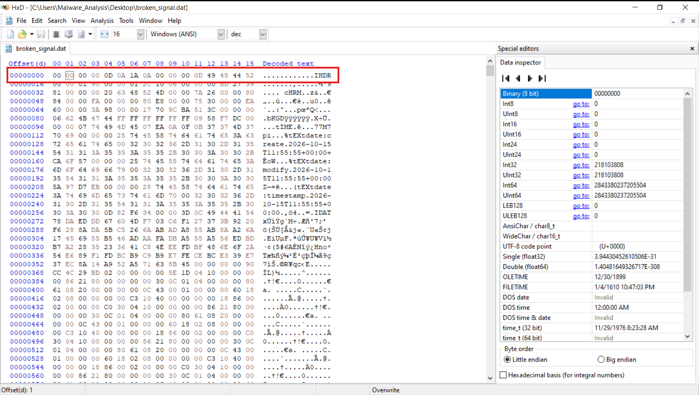{: width="1630" height="921" }
_Phần đầu file bị hỏng, nhưng các byte phía sau vẫn cung cấp manh mối._

Nhìn đoạn này thì có hai chỗ đáng chú ý:

- `49 48 44 52` là chuỗi ASCII **`IHDR`**, chunk đầu tiên của PNG.
- `0D 0A 1A 0A` tại offset `0x04` khớp nửa sau chữ ký PNG.

[Chữ ký PNG](https://www.w3.org/TR/png-3/#5PNG-file-signature) đầy đủ phải là:

```plaintext
89 50 4E 47 0D 0A 1A 0A
```

Vậy là bốn byte đầu đang bị thay bằng `00`. Chỉ đổi đuôi file thôi thì chưa sửa được chỗ này.

### Sửa bốn byte đầu

Tiếp theo mình Save As thành `conmeo.png`, rồi **ghi đè** đúng bốn byte ở offset `0x00-0x03`:

```plaintext
Offset       Trước sửa       Sau sửa
0x00-0x03   00 00 00 00     89 50 4E 47
```

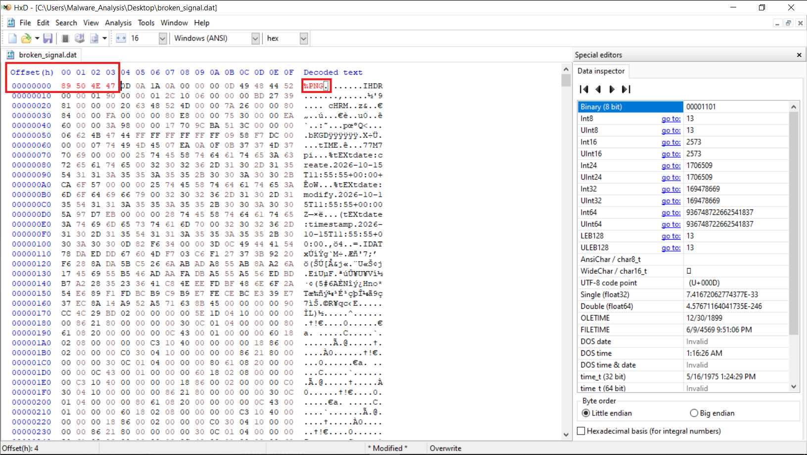{: width="1631" height="921" }
_Khôi phục chữ ký, giữ nguyên vị trí của các chunk phía sau._

Ở đây mình ghi đè chứ không chèn thêm byte. Chữ ký nằm ngoài các chunk nên không cần sửa CRC, kích thước file cũng giữ nguyên.

Mở lại bản đã sửa thì được một ảnh **400 × 300** có dòng `SIGNAL INTERCEPTED`. Flag màu đỏ nằm ngay phía dưới.

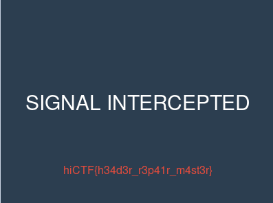{: width="397" height="295" }
_Nội dung ảnh đọc được sau khi sửa header._

### Flag cuối cùng

```plaintext
hiCTF{h34d3r_r3p41r_m4st3r}
```

## Memory Liar

File `memory-liar/memory.raw` dài **16 MiB**, chứa các cấu trúc tiến trình dựng cho bài. Có một tiến trình bị tách khỏi danh sách liên kết. Nếu mình chỉ duyệt danh sách thì có thể thấy nó báo sạch, trong khi quét các record vẫn tìm được tiến trình đó.

### Tìm tiến trình bị unlink

Mình quét ASCII `Proc`, rồi lấy base của từng record như sau:

```plaintext
record_base = offset(Proc) - 4
```

Tiếp đó đọc PID, Flink, Blink và tên tiến trình theo các offset này:

| Offset so với record | Trường         |
| :------------------- | :------------- |
| `+0xBC`              | PID            |
| `+0xC0`              | Flink          |
| `+0xC4`              | Blink          |
| `+0x174`             | Tên tiến trình |

Lưu ý là đây là layout riêng của bài này, không lấy nguyên bộ offset này dùng cho mọi bản Windows được.

Đi theo Flink từ `System` thì mình được:

```plaintext
System > smss > explorer > notepad > sentinel
```

Nhưng khi quét các record thì vẫn thấy **`winxnet.exe`, PID `1337`**, ở offset `0x35D000`. Nó không nằm trong chuỗi trên, còn Flink và Blink thì:

```plaintext
Flink = 0x8035D0C0
Blink = 0x8035D0C0
```

Cả hai đều trỏ về chính list entry của nó, và cũng không có record nào khác trỏ tới nó. Vậy là tiến trình này đã bị unlink. Mình giữ lại PID `1337` để tìm tiếp ở bước sau.

### Đọc vùng ROOT

Đề nói audit báo “sạch”, nên mình nghĩ flag có thể nằm ở tiến trình bị giấu. Sau khi tìm được `winxnet.exe`, mình xem vùng nhớ kế bên thì thấy tại `0x35F000` có magic `ROOT`:

```plaintext
52 4F 4F 54  39 05 00 00  5D 00 00 00  33 00 00 00
R  O  O  T  PID=1337     key=0x5D     length=0x33
```

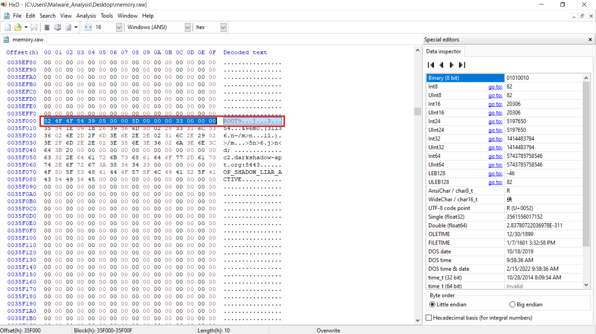{: width="1627" height="914" }
_Header tại offset 0x35F000 nối payload với PID của tiến trình bị ẩn._

`39 05 00 00` đọc little-endian là `0x539 = 1337`, khớp luôn với PID bị ẩn. Header dài `0x10` byte nên payload bắt đầu ở **`0x35F010`**, dài **`0x33 = 51` byte**, khóa XOR là **`0x5D`**.

### Giải XOR payload

Đến đây thì chọn 51 byte từ `0x35F010` trong HxD, copy dạng hex rồi đưa vào CyberChef: **From Hex > XOR**, khóa `5d`, chọn định dạng **HEX**.

Còn trong hình dưới, mình nạp nguyên file `memory.raw` vào CyberChef nên sẽ dùng recipe này:

1. **Drop bytes**: bỏ `3534864` byte đầu, tương ứng offset `0x35F010`.
2. **Take bytes**: lấy `51` byte.
3. **XOR**: khóa hex `5d`.

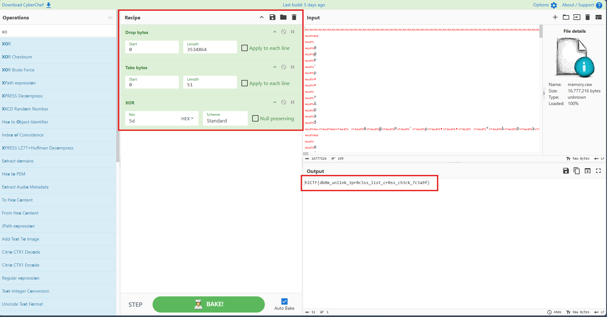{: width="1911" height="999" }
_Recipe xử lý trực tiếp dữ liệu nhị phân và kết quả sau XOR._

### Flag cuối cùng

```plaintext
hiCTF{dk0m_unl1nk_3pr0c3ss_l1st_cr0ss_ch3ck_7c3a9f}
```

## TESSERA

Đề gợi ba tầng: giao tiếp cục bộ qua port, kho cô lập và một đối tượng chuyển hướng. Chúng tương ứng với **ALPC/ETW**, **kho DPAPI** và **NTFS reparse point**. Thư mục đề cho là cây file Windows đã xuất: `tessera/evidence/`.

### Khôi phục phần metadata của log

Ở đây tui sẽ mở thẳng file event log này bằng Event Viewer:

```plaintext
Microsoft-Windows-PowerShell%4Operational.evtx
```

Và như hình dưới thì không có gì hết =)))).

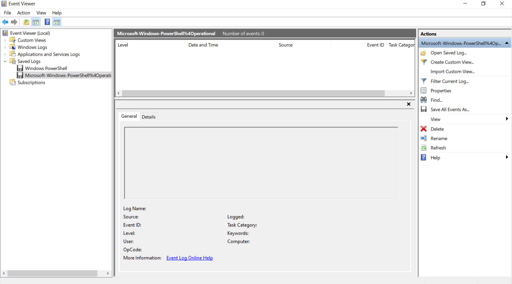{: width="1630" height="907" }
_Event Viewer chưa hiển thị các record của file._

Thì tui có hỏi ChatGPT là tại sao lại như vậy. Chỗ cần kiểm tra tiếp là metadata của log, vì Event Viewer trống chưa chắc là trong file không còn record.

Mình kiểm tra thì các record vẫn còn. Dưới đây là script để fix lại metadata và CRC của chunk: tìm chữ ký `ElfChnk`, duyệt record từ offset `0x200` theo kích thước, rồi ghi kết quả sang `PS_fixed.evtx`.

```python
import struct
import sys
import zlib

CHUNK = 65536
HDR = 4096


def fix_chunk(data, base):
    chunk = bytes(data[base:base + CHUNK])
    if chunk[:8] != b"ElfChnk\x00":
        return False

    offset = 512
    records = []
    while offset + 24 <= CHUNK:
        if chunk[offset:offset + 4] != b"\x2a\x2a\x00\x00":
            break
        size, record_id = struct.unpack_from("<IQ", chunk, offset + 4)
        if size < 24 or offset + size > CHUNK:
            break
        if struct.unpack_from("<I", chunk, offset + size - 4)[0] != size:
            break
        records.append((offset, size, record_id))
        offset += size

    if not records:
        return False

    first_id, last_id = records[0][2], records[-1][2]
    last_offset, last_size, _ = records[-1]
    free_offset = last_offset + last_size

    struct.pack_into("<Q", data, base + 8, first_id)
    struct.pack_into("<Q", data, base + 16, last_id)
    struct.pack_into("<Q", data, base + 24, first_id)
    struct.pack_into("<Q", data, base + 32, last_id)
    struct.pack_into("<I", data, base + 44, last_offset)
    struct.pack_into("<I", data, base + 48, free_offset)

    chunk = bytes(data[base:base + CHUNK])
    data_crc = zlib.crc32(chunk[512:free_offset]) & 0xFFFFFFFF
    struct.pack_into("<I", data, base + 52, data_crc)
    chunk = bytes(data[base:base + CHUNK])
    header_crc = zlib.crc32(chunk[:120] + chunk[128:512]) & 0xFFFFFFFF
    struct.pack_into("<I", data, base + 124, header_crc)

    print(
        f"chunk @{base:#x}: {len(records)} record, "
        f"id {first_id}-{last_id}, free={free_offset:#x}"
    )
    return True


def main(src, dst):
    with open(src, "rb") as source:
        data = bytearray(source.read())
    count = 0
    for base in range(HDR, len(data) - CHUNK + 1, CHUNK):
        count += fix_chunk(data, base)
    with open(dst, "wb") as output:
        output.write(data)
    print(f"xong: sua {count} chunk -> {dst}")


if __name__ == "__main__":
    main(sys.argv[1], sys.argv[2])
```

Tiếp theo trong CMD sử dụng:

```console
python <ten_ban_tu_dat_hiiii>.py "Microsoft-Windows-PowerShell%4Operational.evtx" PS_fixed.evtx
```

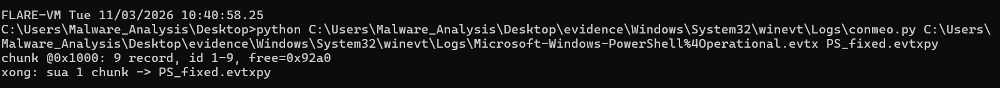{: width="1600" height="142" }
_Chunk tại 0x1000 có 9 record, ID 1-9 và free offset 0x92a0._

Tiếp theo đó mình dùng **EvtxECmd** để trích log ra CSV cho dễ nhìn rồi mở bằng **Timeline Explorer**. Như hình dưới thì ta đã đọc được. Lọc Event ID **`4104`** sẽ thấy ba record chứa `ScriptBlockText` của các stage.

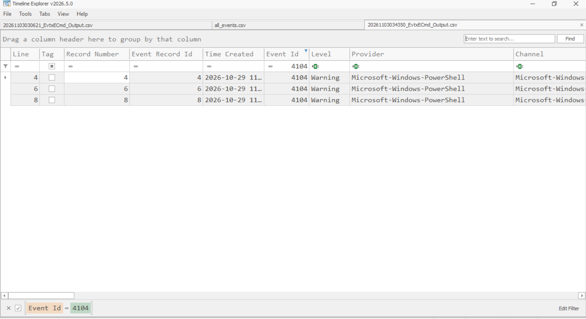{: width="1627" height="886" }
_Các script block cung cấp đầu mối cho cả ba tầng._

### Tầng 1 - Dấu vết ALPC/ETW

Trong script **STAGE 1** có:

```powershell
$FlagPart1   = "1ist-----hiCTF{alpc_p0rt_c0lloquy_"
$Stage2_Clue = "TargetService:DiagTrackSvcAux"
$PortName    = "\RPC Control\AepLocalEndpoint_Q8"
```

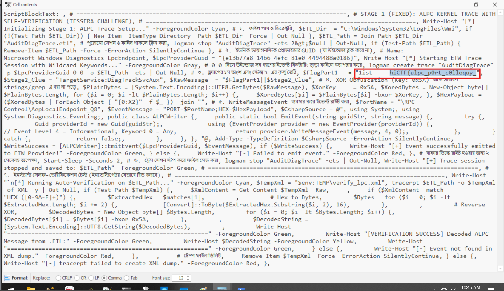{: width="1637" height="943" }
_Mảnh đầu nằm trong biến FlagPart1._

Đoạn này chuẩn bị một ETW event mang nhãn port và dữ liệu đã XOR. Nhưng ngay trong script block thì mình đã thấy chuỗi trước khi làm rối rồi. Bỏ nhãn `1ist-----` là được phần đầu:

```plaintext
hiCTF{alpc_p0rt_c0lloquy_
```

Đoạn `TargetService:DiagTrackSvcAux` cũng gợi service của tầng 2.

### Tầng 2 - Kho DPAPI

Script **STAGE 2** chứa:

```plaintext
FlagPart2 = --s32nd--s35s10n_z3r0_syst3npr0f1l3_
NextKey = T3ss3r4_K3y_8819472MasterSecret!
IV_HEX = 101112131415161718191a1b1c1d1e1f
```

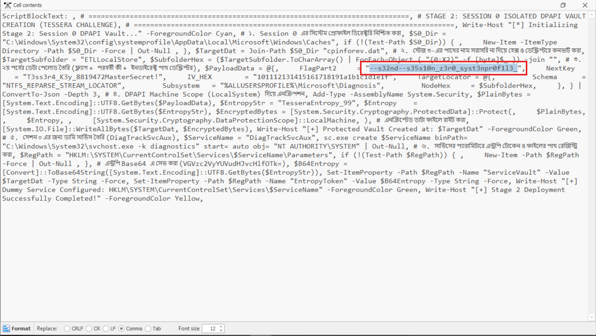{: width="1631" height="920" }
_FlagPart2 cùng các giá trị dùng để nối sang STAGE 3._

Các giá trị này nằm ngay trong `ScriptBlockText`, ở đoạn chuẩn bị dữ liệu trước khi gọi DPAPI. Mình bỏ nhãn `--s32nd--` thì được:

```plaintext
s35s10n_z3r0_syst3npr0f1l3_
```

Giữ nguyên đoạn `syst3npr0f1l3` như trong script nhé. Còn `NextKey` thì để đối chiếu với tầng cuối.

### Tầng 3 - Reparse buffer

Script **STAGE 3** chứa:

```powershell
$Flag3_Raw = "iiiiiiiiiii-3hird---r3p4r53_buff3r_vort3x}"
$SecretKey = "T3ss3r4_K3y_8819472MasterSecret!"
```

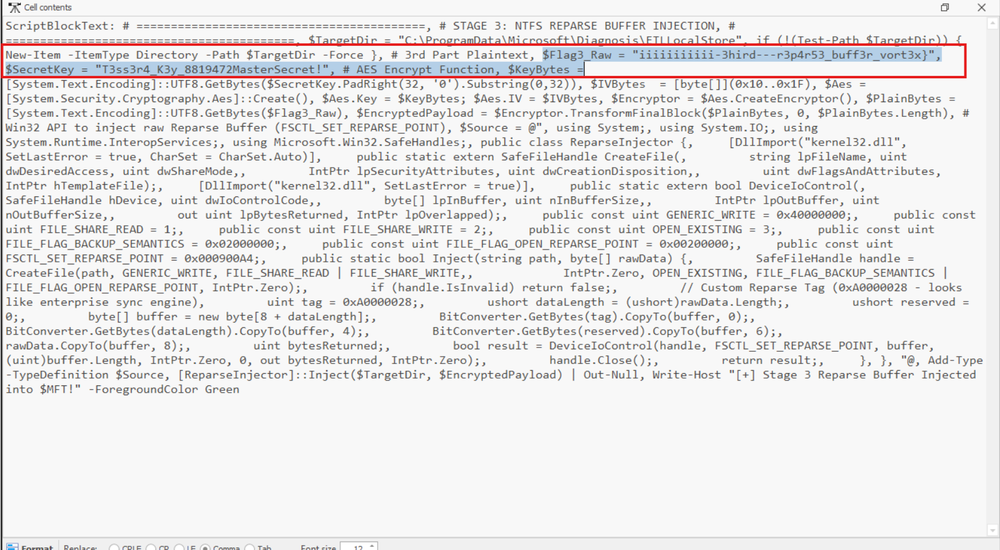{: width="1634" height="899" }
_Chuỗi plaintext được dùng để chuẩn bị payload cho reparse buffer._

`SecretKey` khớp với `NextKey` bên trên. Phần sau chuẩn bị mã hóa AES và ghi payload vào reparse buffer, còn chuỗi `Flag3_Raw` trước khi mã hóa thì đã có ngay trong log.

Bỏ nhãn `iiiiiiiiiii-3hird---`, lấy:

```plaintext
r3p4r53_buff3r_vort3x}
```

### Flag cuối cùng

Giờ ghép ba phần theo thứ tự stage, lấy phần flag thôi chứ không ghép mấy nhãn thứ tự:

```plaintext
hiCTF{alpc_p0rt_c0lloquy_
s35s10n_z3r0_syst3npr0f1l3_
r3p4r53_buff3r_vort3x}
```

Ghép lại thành một dòng là ra flag:

```plaintext
hiCTF{alpc_p0rt_c0lloquy_s35s10n_z3r0_syst3npr0f1l3_r3p4r53_buff3r_vort3x}
```
